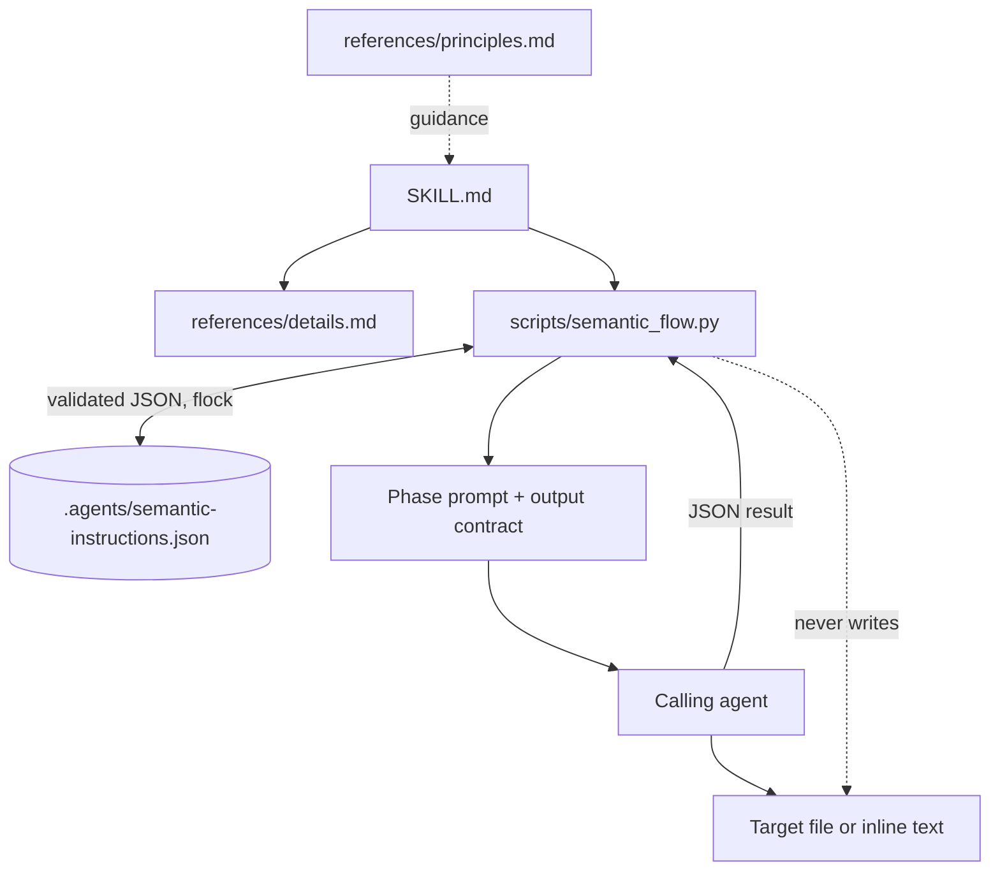
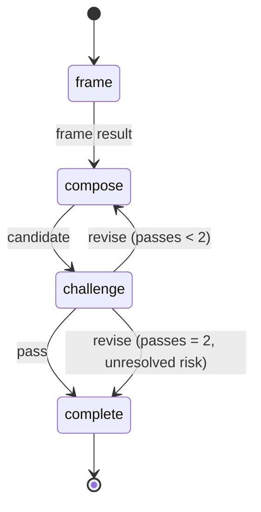

# Architecture

Status: draft, inferred

Reverse-engineered from `SKILL.md`, `references/details.md`, and `scripts/semantic_flow.py`. Confirm before treating as authoritative.

## Purpose

An agent skill that authoring-routes instruction changes through three phases: Frame (read before writing), Compose (smallest sufficient instruction), Challenge (evidence of failure and necessity). The engine stores workflow state and prints prompts; it never writes the target instruction.

## Components

## Phase state machine

- Each phase owns a rotating ticket; a stale or duplicate ticket is rejected.
- `frame` records a target fingerprint; `challenge` rejects if the target changed first.
- State schema is validated on every read and write.
- Writes use a temp file, fsync, and atomic replace under an exclusive `flock` (5 s timeout).

## Invariants

- The engine writes only its own state, never the target.
- A review operation never writes.
- Revision is capped at two passes; residual defects are reported as unresolved risks.
- State and artifacts live under `.agents/`, which is gitignored.

## Files

- `SKILL.md` — trigger, invocation, phase handoff.
- `references/details.md` — phase contract.
- `references/principles.md` — instruction-design principles.
- `scripts/semantic_flow.py` — state engine.
- `tests/test_semantic_flow.py` — unittest suite.
